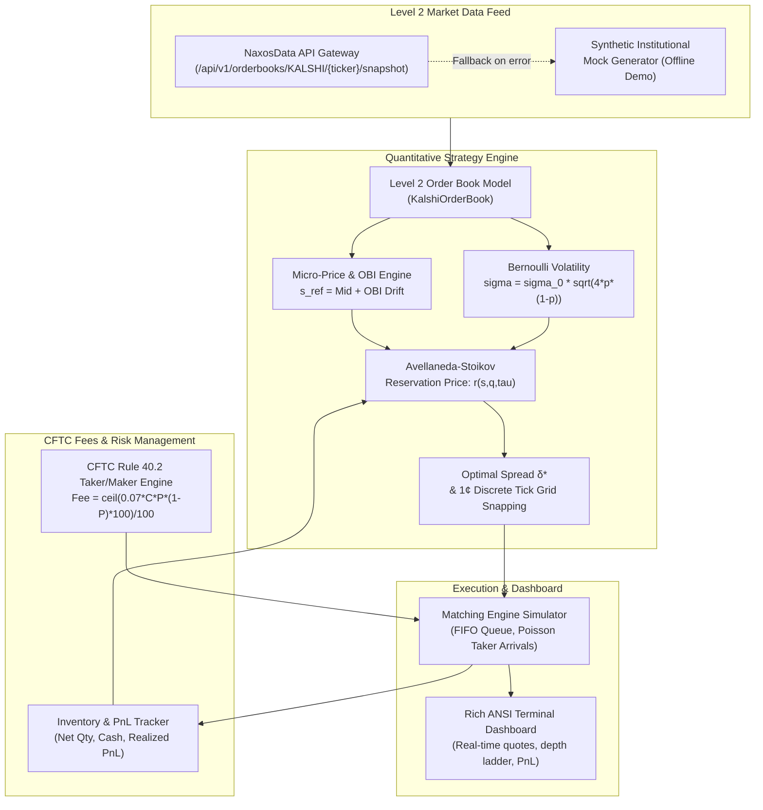

# Kalshi Market Maker Bot

[](https://www.python.org/downloads/)
[](https://opensource.org/licenses/MIT)
[](https://www.cftc.gov)
[](https://naxosdata.com)
[]()

> **Institutional Avellaneda-Stoikov Market Making Engine & CFTC Fee Optimizer for Kalshi Prediction Markets, powered by the NaxosData API Gateway.**

A production-ready quantitative algorithmic trading system tailored specifically for Kalshi (a CFTC-regulated Designated Contract Market). It combines **Avellaneda-Stoikov inventory reservation pricing**, **Order Book Imbalance (OBI) micro-price drift**, **Bernoulli state-dependent volatility**, and exact **CFTC Rule 40.2 quadratic fee optimization** onto Kalshi's discrete 1-cent tick grid.

---

## Targeted Keywords & Industry Concepts

`kalshi market maker bot` · `kalshi trading bot` · `cftc prediction market algorithm` · `avellaneda stoikov kalshi` · `kalshi automated liquidity` · `order book imbalance` · `microstructural alpha` · `prediction market market making` · `high frequency trading`

---

## Table of Contents

- [Why Market Making on Kalshi is Unique](#why-market-making-on-kalshi-is-unique)
- [Mathematical Framework & Formulations](#mathematical-framework--formulations)
  - [1. CFTC Rule 40.2 Quadratic Taker Fee Schedule](#1-cftc-rule-402-quadratic-taker-fee-schedule)
  - [2. Micro-Price and Order Book Imbalance (OBI)](#2-micro-price-and-order-book-imbalance-obi)
  - [3. Bernoulli State-Dependent Volatility](#3-bernoulli-state-dependent-volatility)
  - [4. Bounded Avellaneda-Stoikov Reservation Price](#4-bounded-avellaneda-stoikov-reservation-price)
  - [5. Optimal Quoting Spread and Discrete Cent Grid Snapping](#5-optimal-quoting-spread-and-discrete-cent-grid-snapping)
  - [6. Dynamic Inventory Sizing and Position Limits](#6-dynamic-inventory-sizing-and-position-limits)
- [System Architecture](#system-architecture)
- [NaxosData API Gateway Integration](#naxosdata-api-gateway-integration)
- [Installation](#installation)
- [Quickstart & CLI Commands](#quickstart--cli-commands)
  - [1. CFTC Rule 40.2 Quadratic Fee Verification](#1-cftc-rule-402-quadratic-fee-verification)
  - [2. High-Fidelity Simulation / Demo Mode](#2-high-fidelity-simulation--demo-mode)
  - [3. Production Live Trading with NaxosData Gateway](#3-production-live-trading-with-naxosdata-gateway)
- [CLI Options Reference](#cli-options-reference)
- [Python API Usage](#python-api-usage)
- [Matching Engine Simulator](#matching-engine-simulator)
- [Automated Unit Testing](#automated-unit-testing)
- [License & Institutional Disclaimer](#license--institutional-disclaimer)

---

## Why Market Making on Kalshi is Unique

Unlike traditional equities or perpetual crypto futures, Kalshi operates under unique economic and regulatory constraints:
1. **Binary Bounded Payoffs**: Contracts pay out strictly $0.00 or $1.00 at resolution. All traded prices are bounded within $[0.01, 0.99]$.
2. **Discrete 1-Cent Grid**: Quotes must align to $\$0.01$ tick increments. Sub-penny quoting is prohibited by exchange rules.
3. **CFTC Rule 40.2 Quadratic Fee Asymmetry**: Taker fees follow a quadratic curve that peaks at $P = 0.50$ and approaches zero as $P \to 0$ or $P \to 1$.
4. **Maker Fee Moat**: Designated Contract Market (DCM) liquidity makers enjoy a **0% maker fee** (or negative liquidity rebates), creating an immense structural edge over takers who pay up to $1.75\text{ cents}$ per contract.

---

## Mathematical Framework & Formulations

### 1. CFTC Rule 40.2 Quadratic Taker Fee Schedule

Under Kalshi's regulatory filings with the CFTC (Commodity Futures Trading Commission), taker fees for $C$ contracts executed at price $P \in [0.01, 0.99]$ are calculated via:

$$\text{Fee}_{\text{taker}}(C, P) = \frac{\lceil 0.07 \cdot C \cdot P \cdot (1 - P) \cdot 100 \rceil}{100}$$

Where:
- $C$ is the total number of executed contracts.
- $P$ is the trade price in dollars ($0.01 \le P \le 0.99$).
- $P \cdot (1 - P)$ reflects the Bernoulli variance of the binary payoff.
- The formula computes the raw amount in dollars, scales by $100$ to obtain cents, applies the ceiling function $\lceil \cdot \rceil$ to round up to the nearest whole cent, and converts back to USD.

#### Taker Fee Schedule across the Price Spectrum ($C = 100$ contracts)

| Contract Price ($) | Contract Price (¢) | $P \cdot (1 - P)$ | Taker Fee ($) | Fee / Contract (¢) | Effective Fee Rate |
|:---:|:---:|:---:|:---:|:---:|:---:|
| **$0.05** | 5¢ | 0.0475 | $0.34 | 0.340¢ | 6.80 \text{ percent} of notional |
| **$0.10** | 10¢ | 0.0900 | $0.63 | 0.630¢ | 6.30 \text{ percent} of notional |
| **$0.20** | 20¢ | 0.1600 | $1.12 | 1.120¢ | 5.60 \text{ percent} of notional |
| **$0.30** | 30¢ | 0.2100 | $1.47 | 1.470¢ | 4.90 \text{ percent} of notional |
| **$0.40** | 40¢ | 0.2400 | $1.68 | 1.680¢ | 4.20 \text{ percent} of notional |
| **$0.50** | 50¢ | **0.2500** | **$1.75** | **1.750¢** | **3.50 \text{ percent} of notional** |
| **$0.60** | 60¢ | 0.2400 | $1.68 | 1.680¢ | 2.80 \text{ percent} of notional |
| **$0.70** | 70¢ | 0.2100 | $1.47 | 1.470¢ | 2.10 \text{ percent} of notional |
| **$0.80** | 80¢ | 0.1600 | $1.12 | 1.120¢ | 1.40 \text{ percent} of notional |
| **$0.90** | 90¢ | 0.0900 | $0.63 | 0.630¢ | 0.70 \text{ percent} of notional |
| **$0.95** | 95¢ | 0.0475 | $0.34 | 0.340¢ | 0.36 \text{ percent} of notional |

> **Key Takeaway**: Market makers posting resting limit orders incur **$0.00 maker fees**. Meanwhile, aggressive takers attempting to cross the book pay up to $1.75 per 100 contracts at $0.50. This creates an asymmetric buffer in favor of the market maker.

---

### 2. Micro-Price and Order Book Imbalance (OBI)

To capture immediate order flow momentum without chasing stale mid-prices, the engine blends the raw mid-price with the volume-weighted micro-price and applies an Order Book Imbalance drift:

$$\text{OBI} = \frac{Q_b - Q_a}{Q_b + Q_a} \in [-1.0, +1.0]$$

$$P_{\text{micro}} = \frac{P_b \cdot Q_a + P_a \cdot Q_b}{Q_b + Q_a}$$

$$s_{\text{ref}} = (1 - w_{\mu}) \cdot \left(\frac{P_b + P_a}{2}\right) + w_{\mu} \cdot P_{\text{micro}} + \kappa_{\text{obi}} \cdot \text{OBI} \cdot \Delta_{\text{tick}}$$

Where:
- $P_b, P_a$ are best bid and ask prices.
- $Q_b, Q_a$ are top-of-book available contract sizes.
- $w_{\mu} \in [0, 1]$ is the micro-price weighting coefficient (default: $0.50$).
- $\kappa_{\text{obi}}$ is the imbalance sensitivity factor (default: $0.02$).

---

### 3. Bernoulli State-Dependent Volatility

Standard Avellaneda-Stoikov assumes constant diffusion volatility $\sigma$. However, binary contract terminal variance is strictly governed by Bernoulli variance $\text{Var}(P) = P \cdot (1 - P)$:

$$\sigma(P) = \sigma_0 \cdot \sqrt{4 \cdot P \cdot (1 - P)}$$

The term $4 \cdot P \cdot (1 - P)$ normalizes the volatility multiplier to $1.0$ at $P = 0.50$, naturally shrinking to near zero as the contract becomes deep-in-the-money ($P \to 0.99$) or deep-out-of-the-money ($P \to 0.01$).

---

### 4. Bounded Avellaneda-Stoikov Reservation Price

The reservation (indifference) price $r(s, q, \tau)$ represents the price at which the market maker is indifferent between holding their current inventory $q$ and executing one additional unit:

$$r(s, q, \tau) = s_{\text{ref}} - q \cdot \gamma \cdot \sigma^2(P) \cdot \tau$$

Where:
- $q \in [-Q_{\max}, Q_{\max}]$ is the net contract inventory ($+q$ = long YES, $-q$ = short YES).
- $\gamma > 0$ is the risk aversion parameter (default: $0.15$).
- $\tau = T - t$ is the normalized time horizon remaining.
- When $q > 0$ (long inventory), $r < s_{\text{ref}}$: the reservation price drops, forcing quotes downward to deter buyers and encourage sellers.
- When $q < 0$ (short inventory), $r > s_{\text{ref}}$: the reservation price rises, forcing quotes upward to cover shorts.
- The reservation price is strictly bounded: $r \in [0.01, 0.99]$.

---

### 5. Optimal Quoting Spread and Discrete Cent Grid Snapping

The unconstrained optimal half-spread $\delta^*$ is derived from the closed-form Avellaneda-Stoikov solution:

$$\delta^*(s) = \frac{\gamma \cdot \sigma^2(P) \cdot \tau}{2} + \frac{1}{\gamma} \ln\left(1 + \frac{\gamma}{\kappa}\right)$$

Where $\kappa$ is the order book arrival intensity parameter.

Raw continuous quotes are generated around the reservation price:
$$p^b_{\text{raw}} = r - \delta^* \qquad p^a_{\text{raw}} = r + \delta^*$$

Quotes are then snapped to Kalshi's discrete 1-cent tick grid ($\Delta_{\text{tick}} = \$0.01$):
$$p^b = \text{round}\left(\frac{p^b_{\text{raw}}}{\Delta_{\text{tick}}}\right) \cdot \Delta_{\text{tick}} \qquad p^a = \text{round}\left(\frac{p^a_{\text{raw}}}{\Delta_{\text{tick}}}\right) \cdot \Delta_{\text{tick}}$$

Guarantees enforced by the strategy:
1. **Boundary constraints**: $0.01 \le p^b < p^a \le 0.99$.
2. **Non-crossing constraint**: $p^a \ge p^b + 0.01$.

---

### 6. Dynamic Inventory Sizing and Position Limits

To prevent inventory blowouts while maintaining quoting presence, the quote sizes adapt linearly:

$$\text{Size}_{\text{bid}} = \text{round}\left(Q_0 \cdot \max\left(0, 1 - \frac{q}{Q_{\max}}\right)\right)$$

$$\text{Size}_{\text{ask}} = \text{round}\left(Q_0 \cdot \max\left(0, 1 + \frac{q}{Q_{\max}}\right)\right)$$

- If $q \ge Q_{\max}$: $\text{Size}_{\text{bid}} = 0$ (hard stop on buying YES).
- If $q \le -Q_{\max}$: $\text{Size}_{\text{ask}} = 0$ (hard stop on selling YES).

---

## System Architecture



---

## NaxosData API Gateway Integration

The market maker is powered by the **NaxosData API Gateway** (`api.naxosdata.com`), providing institutional-grade, low-latency prediction market feeds:

- **L2 Orderbook Snapshots**:
  ```http
  GET /api/v1/orderbooks/KALSHI/{ticker}/snapshot
  Host: api.naxosdata.com
  x-api-key: YOUR_NAXOS_API_KEY
  ```
  Returns a normalized Level 2 ladder with validated cent tick prices, contract quantities, and millisecond timestamps.

- **Market Universe Discovery**:
  ```http
  GET /api/v1/markets?venue=KALSHI
  Host: api.naxosdata.com
  ```
  Returns all active Kalshi event contracts, strike prices, expiration horizons, and 24-hour volume metrics.

- **Resilience & Offline Demo**:
  If the API key is omitted, network connectivity drops, or `--demo` is passed, the client automatically switches to the built-in **`SyntheticKalshiOrderBookGenerator`** with zero crashes, generating realistic Ornstein-Uhlenbeck mean-reverting price walks and Poisson depth ladders.

---

## Installation

### Prerequisites
- Python 3.10, 3.11, 3.12, 3.13, or 3.14
- Standard terminal with ANSI color support

### Clone and Install
```bash
git clone https://github.com/nexosdata/kalshi-market-maker-bot.git
cd kalshi-market-maker-bot

# Install dependencies and CLI commands in editable mode
pip install -e .
```

---

## Quickstart & CLI Commands

### 1. CFTC Rule 40.2 Quadratic Fee Verification
Inspect the regulatory quadratic fee schedule and verify taker costs across the entire $[0.01, 0.99]$ contract spectrum:

```bash
kalshi-mm --cftc-fee-check
```

### 2. High-Fidelity Simulation / Demo Mode
Run a 30-step market making simulation on the Fed Funds Rate contract (`KXFED-24DEC-T5.00`) with simulated order flow and adverse selection:

```bash
kalshi-mm --demo --ticker KXFED-24DEC-T5.00 --sim-steps 30 --interval 0.1
```

### 3. Production Live Trading with NaxosData Gateway
Connect live to Kalshi feeds via NaxosData API Gateway:

```bash
export NAXOS_API_KEY="your-api-key-here"
kalshi-mm --ticker PRES-2024 --api-key $NAXOS_API_KEY --quote-size 15 --gamma 0.20
```

---

## CLI Options Reference

| Argument | Type | Default | Description |
|:---|:---:|:---:|:---|
| `--ticker` | `str` | `KXFED-24DEC-T5.00` | Kalshi instrument ticker symbol |
| `--api-key` | `str` | `None` | NaxosData API Gateway authentication key |
| `--base-url` | `str` | `https://api.naxosdata.com` | Base URL for NaxosData API Gateway |
| `--demo`, `--mock` | `flag` | `False` | Run in offline synthetic demo simulation mode |
| `--cftc-fee-check`| `flag` | `False` | Print CFTC Rule 40.2 quadratic fee curve and exit |
| `--gamma` | `float`| `0.15` | Risk aversion coefficient $\gamma$ (higher = faster skew) |
| `--quote-size` | `int` | `10` | Base order lot size in contracts ($Q_0$) |
| `--max-position` | `int` | `100` | Hard position limit before one-sided quoting stops ($Q_{\max}$) |
| `--min-spread` | `float`| `2.0` | Minimum bid/ask spread constraint in cents |
| `--initial-cash` | `float`| `10000.0` | Starting cash balance in USD |
| `--sim-steps` | `int` | `25` | Number of simulation iterations to execute |
| `--interval` | `float`| `0.08` | Refresh sleep interval in seconds |

---

## Python API Usage

### Quoting Engine Example

```python
from kalshi_mm.models import KalshiOrderBook, KalshiPosition, PriceLevel
from kalshi_mm.strategy import KalshiAvellanedaStoikovMM, StrategyConfig

# 1. Initialize strategy configuration
config = StrategyConfig(
    gamma=0.15,               # Risk aversion
    base_quote_size=10,        # 10 contracts per quote
    max_position=100,          # Maximum allowable inventory
    min_spread_cents=2.0,      # Minimum 2¢ spread
)
strategy = KalshiAvellanedaStoikovMM(config=config)

# 2. Ingest Level 2 orderbook snapshot
book = KalshiOrderBook(
    ticker="KXFED-24DEC-T5.00",
    bids=[PriceLevel(price=0.52, size=150), PriceLevel(price=0.51, size=300)],
    asks=[PriceLevel(price=0.56, size=120), PriceLevel(price=0.57, size=240)],
)

# 3. Track active position
position = KalshiPosition(ticker="KXFED-24DEC-T5.00", net_quantity=20)

# 4. Generate Avellaneda-Stoikov discrete quote
quote = strategy.generate_quote(book, position)

print(f"Ref Price:    ${strategy.calculate_drift_adjusted_mid(book):.4f}")
print(f"Reservation:  ${quote.reservation_price:.4f}")
print(f"Optimal Bid:  ${quote.bid_price:.2f} x {quote.bid_size} contracts")
print(f"Optimal Ask:  ${quote.ask_price:.2f} x {quote.ask_size} contracts")
print(f"Spread:       {quote.spread_cents:.1f}¢")
```

### CFTC Rule 40.2 Fee Calculation Example

```python
from kalshi_mm.cftc_fees import (
    calculate_cftc_taker_fee,
    calculate_cftc_maker_fee,
    calculate_net_spread_after_cftc_fees,
)

# Calculate taker fee for 100 contracts at $0.50
taker_fee = calculate_cftc_taker_fee(contracts=100, price=0.50)
print(f"Taker fee: ${taker_fee:.2f}")  # Returns $1.75

# Calculate maker fee (0% standard DCM tier)
maker_fee = calculate_cftc_maker_fee(contracts=100, price=0.50)
print(f"Maker fee: ${maker_fee:.2f}")  # Returns $0.00

# Net captured spread on 100 contracts between 50¢ bid and 54¢ ask
net_spread = calculate_net_spread_after_cftc_fees(
    bid_price=0.50,
    ask_price=0.54,
    contracts=100,
    is_maker=True,
)
print(f"Maker net spread captured: ${net_spread:.2f}")  # Returns $4.00
```

---

## Matching Engine Simulator

The repository includes a simulation suite (`MarketSimulator`) modeling:
- **FIFO Queue Priority**: Orders sit behind existing book depth; priority advances as taker volume consumes depth.
- **Poisson Arrival Intensity**: Arrival probability decays exponentially with distance from mid-price:
  $$\lambda(p) = A \cdot \exp\left(-k \cdot |p - s_{\text{ref}}|\right)$$
- **Adverse Selection Shocks**: Simulates informed order flow where price jumps coincide with aggressive taker sweeps.
- **PnL Time-Series**: Tracks realized PnL, mark-to-market unrealized PnL, maximum drawdown, and annualized Sharpe ratios.

```python
from kalshi_mm.simulator import MarketSimulator

sim = MarketSimulator(ticker="KXFED-24DEC-T5.00", seed=42)
result = sim.run_simulation(steps=50)

print(f"Total Trades:     {result.total_trades}")
print(f"Final Inventory:  {result.final_inventory} contracts")
print(f"Realized PnL:     ${result.realized_pnl:+.2f}")
print(f"Sharpe Ratio:     {result.sharpe_ratio:.2f}")
print(f"Max Drawdown:     ${result.max_drawdown_usd:.2f}")
```

---

## Automated Unit Testing

The repository includes a 100% passing test suite across all modules:
- CFTC Rule 40.2 exact quadratic taker calculations & edge cases
- Avellaneda-Stoikov reservation price bounds & inventory skew logic
- Order book imbalance (OBI) and micro-price weighting
- FIFO queue priority and matching engine mechanics
- Resilient NaxosData API Gateway client and fallback handling
- CLI parser, dashboard rendering, and exit codes

To run the automated tests:
```bash
python3 -m unittest discover tests -v
```

Expected output:
```text
Ran 35 tests in 0.030s

OK
```

---

## License & Institutional Disclaimer

This project is licensed under the **MIT License** — see the [LICENSE](LICENSE) file for details.

### Institutional Disclaimer
*This repository is developed for algorithmic trading research and quantitative educational purposes. Trading binary contracts and event derivatives on Designated Contract Markets (DCM) regulated by the CFTC involves substantial financial risk of loss. Past simulation results or backtests are not indicative of future performance. NaxosData and the contributors accept no liability for financial losses incurred through live trading.*
